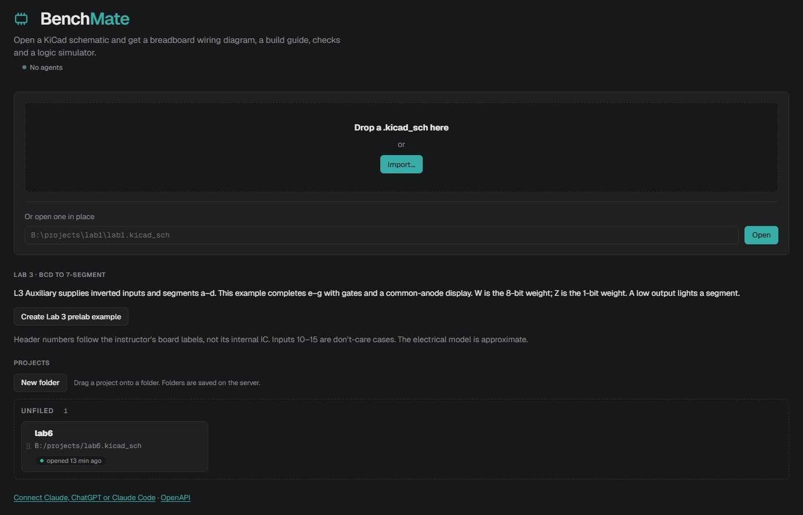
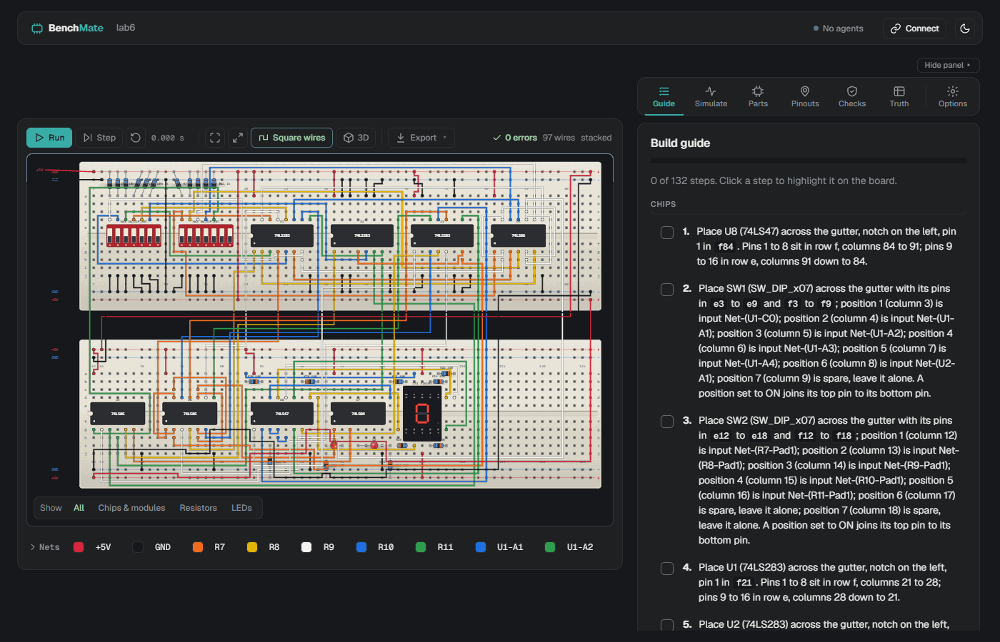
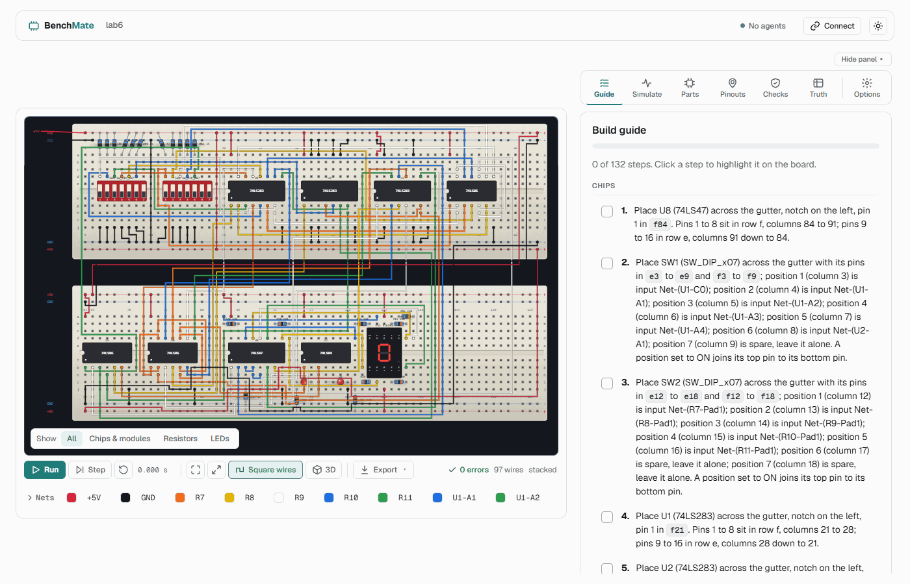
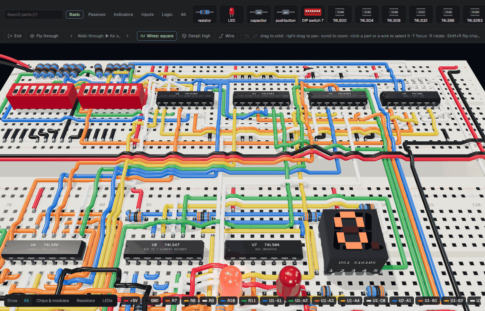
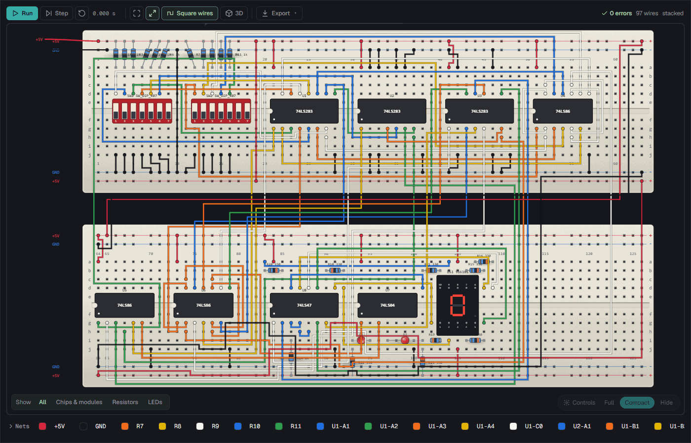
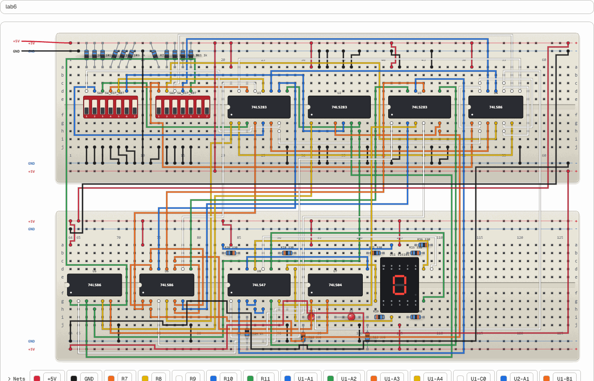

# BenchMate

BenchMate reads a KiCad schematic and lays it out on a breadboard. You get a
numbered build guide that names every hole, wiring checks, and a logic
simulator you drive by clicking the switches. Everything is also a REST API
and an MCP server, so Claude Desktop, Claude Code and ChatGPT can open a
schematic, edit it, and check the wiring.

It was built for ECE 2300L: 74LS-series chips, DIP switches, LEDs, and the
5161BS common-anode display from the lab kit.

## Run it

    docker compose up --build -d      # http://localhost:8765
    docker compose down               # stop (add -v to drop the cache volume)

Your KiCad projects folder (`Documents\KiCad\9.0\projects` by default) is
mounted at `/projects`. Create it before the first `docker compose up`;
otherwise Docker Desktop makes an empty root-owned folder there. To use a
different folder, set `KICAD_PROJECTS` in `.env` (see `.env.example`).

The port is bound to localhost. Set `CIRCUIT_HOST_PORT=8766` in `.env` to run
a second copy beside it. The recent-projects list, folders and the kicad-cli
cache live in the `circuit-data` volume.

Without Docker:

    bun install
    bun run build      # after any client change
    bun start          # http://localhost:8765

## Use it

Open a `.kicad_sch` from the home page, or type its path. Drag parts to move
them, click switches to change inputs, and tick off guide steps as you wire.
Saving the schematic in KiCad reloads the board.

Moved parts, board options, wire colours and saved tests go in
`NAME.breadboard.json` beside the schematic, so they travel with the project.

Large circuits: pick **stacked** under Options to lay the circuit over two
full boards, one above the other. Columns run 1-63 on the top board and
64-126 on the bottom one, so a step such as "a70" means the bottom board.

Saved tests: each one is a set of switch positions plus what the LEDs and
display should show. Pick one in the Simulate tab and BenchMate sets the
switches and marks it Pass or Fail. Write them with the `set_sim_tests` MCP
tool or `POST /api/projects/<id>/layout/tests`.

The simulator models 74LS gates, the 74LS138, 74LS283 and 74LS47/48. Other
parts are placed and checked but not simulated, and the analog model is
approximate.

**Create Lab 3 prelab example** on the home page builds the BCD to
seven-segment circuit on the instructor's L3 Auxiliary board. Its header,
pinout and limits are in [docs/lab3.md](docs/lab3.md).

## Connect an assistant

`http://localhost:8765/#/connect` has copy-paste setup for each client. The
MCP endpoint is `/mcp` (`/mcp-server/mcp` also works). Claude Desktop can
use the stdio entry point, `bun server/mcp-stdio.ts`. ChatGPT only reaches
servers on the internet, so it needs a tunnel; cloudflared is in the image at
`/usr/local/bin/cloudflared`.

Windows paths from Claude Code or the API are mapped to `/projects/...`, and
the MCP server is still registered as `circuit-designer`, so existing setups
keep working after the rename.

## Develop

    bun test
    bun run typecheck
    bun run breadboard path/to/project.kicad_sch   # layout JSON and SVG beside it
    bun run docker:smoke                           # end-to-end check against the container
    bun run models                                 # rebuild the 3D part models in public/models

`bun run models` needs a local KiCad 9 and is only for re-exporting the part
models; the converted files are committed, so running the app does not need it
(see [docs/editor3d.md](docs/editor3d.md)).

The image is `kicad/kicad:9.0.9` (kicad-cli and the stock symbol libraries)
with bun added. The original design notes are in
`docs/superpowers/specs/2026-09-03-circuit-ai-tool-design.md`.

## Environment variables

Choose **Create Lab 3 prelab example** on the home page to create an editable
BCD-to-seven-segment circuit using the instructor's L3 Auxiliary module.
The module is also available in the part picker. See [Lab 3 notes](docs/lab3.md)
for its labeled header, logic expressions, display pinout, and model limits.

    bun run build      # once, and after client changes
    bun start          # http://localhost:8765

Open a `.kicad_sch` from the home page (your `Documents\KiCad\9.0\projects`
folder is scanned), drag parts, click switches, follow the guide, print it.
Moved parts, options and colours are saved in `NAME.breadboard.json` next to
the schematic. Saving the schematic in KiCad reloads the board.

## 3D editor

Press **3D** on a project to open the full-screen 3D editor. Click a part to select it, then drag it to new holes, turn it (R), flip a chip (Shift+R), edit its value or delete it from the card beside it, and press F to fly to it. The **Detail** button switches between real KiCad part bodies and simple shapes. With square wires, click a jumper to reshape it by its handles or recolour its net (keys 1 to 9). Ctrl+Z undoes layout changes. A parts tray (press / to search) adds parts: drag a tile onto a hole, or tap it and click one. The wire tool (W) draws a jumper that joins a loose leg to a net, and D duplicates the selected part. Tray drops, jumpers, duplicates and deletes edit the schematic after a backup and are not on Ctrl+Z. See [docs/editor3d.md](docs/editor3d.md). Agents working on the code should read [AGENTS.md](AGENTS.md).

## Look and feel

The interface uses flat surfaces on a neutral dark gray (`#18191B` page,
`#1F2022` cards), 1px borders and one accent colour. The palette:

| Colour | Hex | Used for |
|---|---|---|
| teal | `#39AEA9` | primary buttons, the selected tab, focus rings, progress |
| mint | `#A2D5AB` | success text, "on" states, 0 errors |
| slate | `#557B83` | outlines of toggled-on buttons, secondary marks |
| cream | `#E5EFC1` | the outline of toast notices |

Light mode (the moon/sun button in the app bar) uses the same layout on an
off-white page with white cards. Teal and mint are darkened there
(`#1F7C78`, `#2E7D53`) so text on them stays readable. Printing always uses
a white page. The 3D editor stays dark in both modes.

- Colour tokens live in `client/styles.css`: the `:root` block (light), the
  `:root[data-theme="dark"]` block, and a copy of the dark values on `.ws`
  for the 3D editor.
- Icons are inline line SVGs in `client/icons.ts`.
- Wire, LED and board colours, and the dark well behind the board, are left
  out of the theme on purpose: they carry meaning or are tuned so a lit LED
  reads as lit.
- `test/ui-contrast.test.ts` checks the WCAG contrast of the main token pairs
  in both modes (4.5:1 for text, 3:1 for UI marks) and that the `.ws` and
  `prefers-color-scheme` blocks match the dark theme.

Screenshots (lab 6 test fixture) are in [docs/img/ui](docs/img/ui):

| | |
|---|---|
|  |  |
|  |  |
|  |  |

## Run in Docker

    docker compose up --build -d      # http://localhost:8765, restarts with Docker Desktop
    bun run docker:smoke              # optional: end-to-end check against the container
    docker compose down               # stop; `docker compose down -v` also drops the cache volume

The image is `kicad/kicad:9.0.9` (kicad-cli plus the stock symbol libraries)
with bun added. Your KiCad projects folder is mounted at `/projects`; it must
already exist before `docker compose up`, since Docker Desktop otherwise
creates an empty root-owned folder there instead of refusing to start. Set
`KICAD_PROJECTS` in a `.env` file (see `.env.example`) to use another folder.
Windows paths sent by Claude Code or the API are translated into `/projects/...`
automatically. The recent list and the kicad-cli cache live in the
`circuit-data` volume; cloudflared is baked into the image at
`/usr/local/bin/cloudflared`. Port 8765 is bound to localhost only; set
`CIRCUIT_HOST_PORT=8766` in `.env` to run it beside `bun start`.

The old `circuit-designer` container used the same port and the same Claude
Code registration (`/mcp-server/mcp`), so nothing needs re-registering.

## Connect Claude, ChatGPT or Claude Code

Open `http://localhost:8765/#/connect` for copy-paste snippets. The MCP
endpoint is `/mcp` (alias `/mcp-server/mcp`); a stdio entry point for Claude
Desktop is `bun server/mcp-stdio.ts`. ChatGPT needs a tunnel (cloudflared or
ngrok) because it only reaches servers on the internet.

## Environment

| Variable | Default | What it does |
|---|---|---|
| `CIRCUIT_PORT` | 8765 | Port the server listens on |
| `CIRCUIT_HOST` | 127.0.0.1 | Address it binds to |
| `CIRCUIT_HOST_PORT` | 8765 | Host port in docker-compose |
| `KICAD_PROJECTS` | `Documents\KiCad\9.0\projects` | Folder mounted at `/projects` |
| `PROJECTS_DIR` | | Folder scanned for schematics |
| `DATA_DIR` | `%LOCALAPPDATA%\UniversityTools\circuit` | Recent list, folders, cache |
| `KICAD_CLI`, `KICAD_SYMBOL_DIR`, `KICAD_SYM_LIB_TABLE` | | Where KiCad lives |
| `CIRCUIT_PATH_MAP` | | `hostPrefix=containerPrefix;...` path translation |
| `CIRCUIT_WATCH_POLL_MS` | | Poll the open schematic instead of inotify (the container uses 1000) |
| `CIRCUIT_PNG_FONT`, `CIRCUIT_CONTAINER` | | PNG export font, container name for the connect page |
